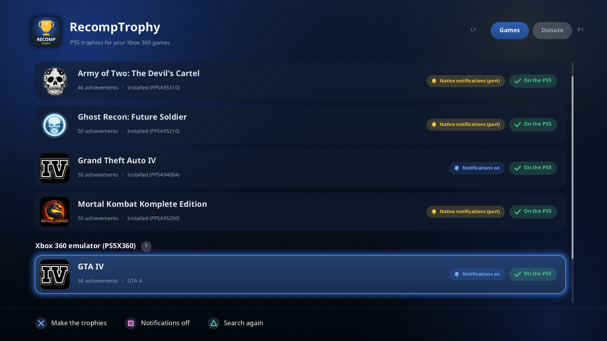
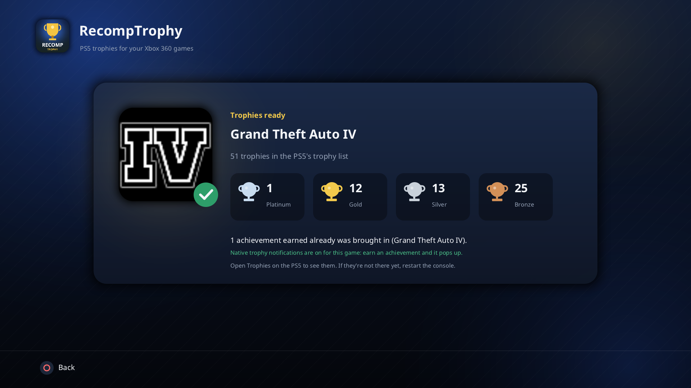
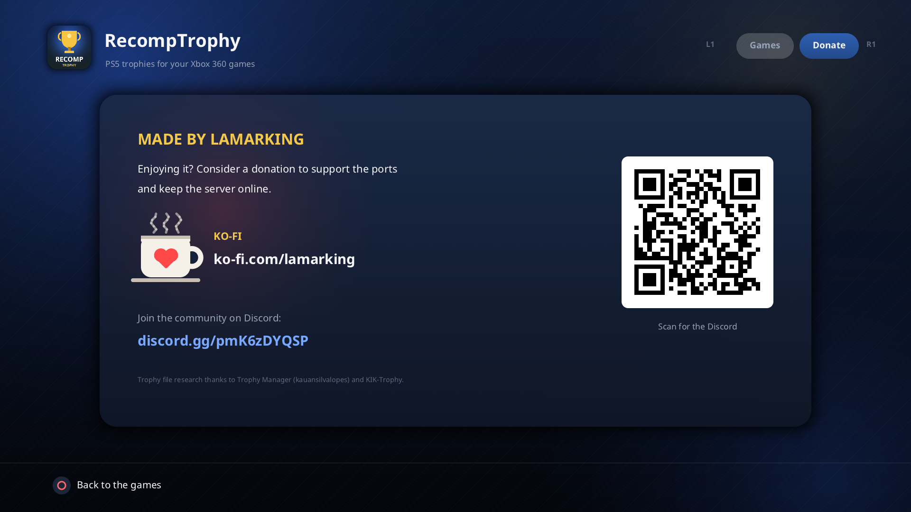

# RecompTrophy

**Native PS5 trophies for your Xbox 360 games on a jailbroken PS5.** Pick a game and RecompTrophy reads its achievements (names, descriptions, pictures) and turns them into a real PS5 trophy set: the game shows up in the console's own **Trophies** list, with bronze, silver and gold trophies and a platinum, and the achievements you already earned are brought in with their dates. From then on, every achievement you earn pops up as **the console's own trophy notification**, with the trophy's picture and sound. All offline.



| Trophies ready | Donate |
|---|---|
|  |  |

## Download
Get the latest version from **[Releases](../../releases/latest)**.

## What it works with
| Where the game is | Trophies made from | Achievements brought in | Native notifications |
|---|---|---|---|
| A **ReXGlue port** installed in `/data/homebrew/` (extracted game) | the installed game | from the port | yes |
| The **PS5X360** emulator's library (extracted games and `.iso`) | the game in the library | from the emulator's profiles | yes |
| A disc image (`.iso`) on the console, a USB drive or the extended storage | the image | from the port or emulator, if any | yes, if a port or emulator plays it |

Ports that already show native PS5 trophies of their own (Army of Two: The Devil's Cartel, Mortal Kombat Komplete Edition and Ghost Recon: Future Soldier's PS5 ports) are recognized, so their notifications never show twice.

GOD / STFS packages aren't read yet.

## What it does
- Reads the game's achievements straight from its `default.xex` (inside an `.iso`, or an installed game), with their pictures, in English and, when the game has it, Portuguese
- Makes the game's PS5 trophy set: its achievements as trophies (graded by gamerscore: up to 10 bronze, up to 25 silver, more gold) plus a platinum, with the pictures at 512x512
- Puts the game in your profile's PS5 Trophies list, with the achievements you already earned in the port or in the emulator's profiles, at the dates you earned them
- **Native trophy notifications while you play**, for ports and the emulator that don't have them: a small watcher stays loaded and, as soon as the game records an achievement, marks the trophy and shows the console's own notification. Turn it off for a game with Square.
- Puts the watcher in the **Payload Manager**'s autoload list, so it's loaded at every start of the console
- Making a game again updates it: its trophies are never listed twice

## What you need
- A jailbroken PS5 that runs homebrew apps from `/data/homebrew/`
- A payload loader on port 9021 (etaHEN, elfldr or any other): RecompTrophy needs it to write where the console keeps trophies
- Your **own** Xbox 360 games, as a port, in the emulator's library, or as `.iso`. No game files are included.
- At least one PS5 game with trophies played once on your profile: your trophy progress is made from it

## Install
1. Download the latest `RecompTrophy-*.zip` from [Releases](../../releases/latest) and copy its `PPSA95400` folder to `/data/homebrew/` on your PS5.
2. Launch **RecompTrophy**. It looks for your games: the installed ports first, then the emulator's library, then disc images.
3. Pick a game and press Cross. In a few seconds its trophies are in the PS5's Trophies list. If they don't show up yet, restart the console.

To update, copy the new `PPSA95400` folder over the old one.

## Controls
| Button | Does |
|---|---|
| Up / Down | Pick a game |
| Cross | Make its trophies (again: update them) |
| Square | Turn the game's native notifications on or off |
| Triangle | Search again |
| L1 / R1 | The Games and Donate tabs |
| Circle | Back |

## Good to know
- After restarting the console, the watcher is loaded again by the Payload Manager. Without the Payload Manager, open RecompTrophy once.
- The trophies are local, like the console's own offline trophies. Keep your console offline from PSN while using it.
- RecompTrophy keeps its own files in `/data/trophies360/`.

> [!TIP]
> ### ❤️ Enjoying it?
> Consider a donation to support the ports and keep the server online: **[ko-fi.com/lamarking](https://ko-fi.com/lamarking)**. Thank you!
>
> Questions or problems? Talk to us on **[Discord](https://discord.gg/pmK6zDYQSP)**.

## Building
RecompTrophy is a plain C++20 PS5 app: it draws its screen on the CPU through VideoOut, with no GPU library. Build it with the PS5 tooling of [ps5-plume-triangle](https://github.com/Nazky/ps5-plume-triangle) (its app CRT, link recipe, `libc.prx` and FSELF signer) and the PS5 Payload SDK it sets up:

```
tools/build.sh <ps5-plume-triangle checkout> [title id]
```

The app folder is written to `build/app/PPSA95400/`. The libraries it uses are in `third_party/`, each with its license.

## Credits
- **[Trophy Manager](https://github.com/kauansilvalopes/trophy)** (kauansilvalopes) and **[KIK-Trophy](https://github.com/kiikeep/KIK-Trophy)**: what's known about the PS5's trophy files, which RecompTrophy builds on
- **[ReXGlue](https://github.com/rexglue/rexglue-sdk)** and **elripalda**'s PS5 layer: the ports RecompTrophy was made for
- **[Nazky](https://github.com/Nazky)** ([ps5-plume-triangle](https://github.com/Nazky/ps5-plume-triangle)) and **[mihawk-99](https://github.com/mihawk-99)** (the PS5 Payload SDK fork): the PS5 build tooling
- **[BrinooTk](https://github.com/BrinooTk/PS5X360)**: the PS5X360 emulator, whose library and profiles RecompTrophy reads
- The libraries in [THIRD_PARTY_NOTICES.md](THIRD_PARTY_NOTICES.md)
- Made by **lamarking**

## License
RecompTrophy is free software under the [GNU General Public License v3.0](LICENSE). The libraries in `third_party/` and the fonts keep their own licenses ([THIRD_PARTY_NOTICES.md](THIRD_PARTY_NOTICES.md)).
